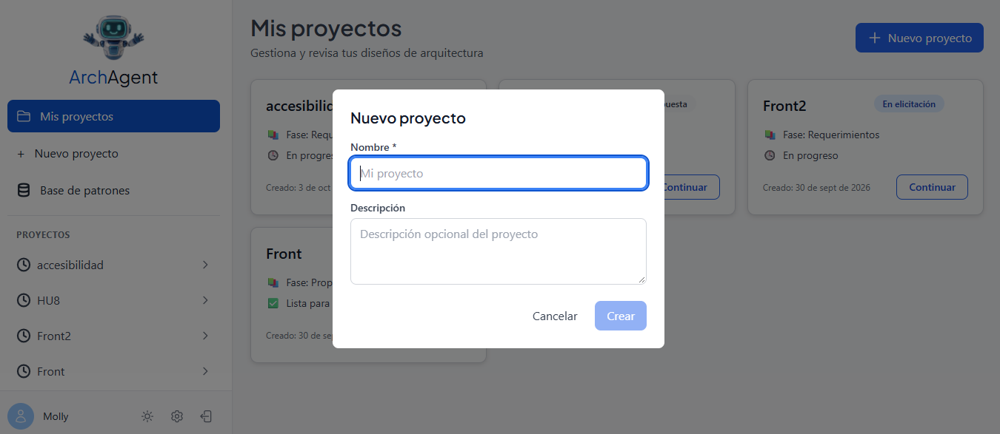
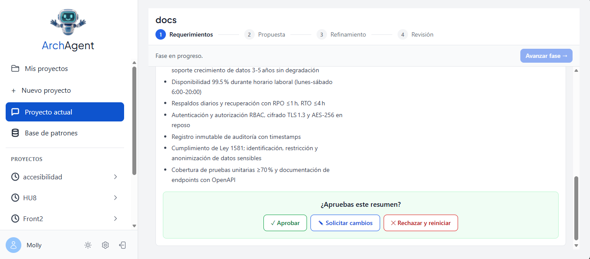

# Guía de inicio rápido

De cero a tu primera propuesta de arquitectura en cinco pasos. Si quieres el detalle de cada pantalla, sigue con el [tutorial paso a paso](02-tutorial.md).

> **Antes de empezar:** Arch Agent tiene que estar corriendo. En una instalación local se levanta con `docker compose up -d` (ver el [README principal](../../README.md#quickstart)) y la app queda en **http://localhost:5173**.

---

## 1. Crea tu cuenta

1. Abre **http://localhost:5173**.
2. Haz clic en **Regístrate** (debajo del formulario de inicio de sesión).
3. Completa **Nombre de usuario**, **Correo electrónico**, **Contraseña** y **Repetir contraseña**. La contraseña debe tener **al menos 8 caracteres, una mayúscula, un número y un carácter especial** (por ejemplo, `Turnos#2026`).
4. Haz clic en **Registrarse**: entras automáticamente a **Mis proyectos**.

## 2. Configura tu LLM (obligatorio)

El agente necesita un modelo de lenguaje para funcionar. En la barra lateral, abajo, haz clic en el ícono de engranaje (**Configuración LLM**) y completa el asistente de 3 pasos:

| Paso | Qué ingresar | Ejemplo |
|------|--------------|---------|
| 1. URL base | La URL del proveedor | `https://api.openai.com/v1` |
| 2. API Key | Tu clave del proveedor | `sk-...` |
| 3. Modelo | Elige uno de la lista | `gpt-4o` |

Prefiere los modelos del grupo **"Recomendados (Tier 1)"** de la lista.

> ¿Usas **Ollama** o **LM Studio** en tu máquina? Usa `http://host.docker.internal:11434/v1` (Ollama) o `http://host.docker.internal:1234/v1` (LM Studio) en lugar de `localhost`.

## 3. Crea un proyecto

1. Haz clic en **+ Nuevo proyecto** (barra lateral) o en **Nuevo proyecto** (pantalla **Mis proyectos**).
2. Escribe un **nombre** y, opcionalmente, una **descripción** de la idea.
3. Haz clic en **Crear**: se abre el chat del proyecto en la fase **Requerimientos**.

## 4. Responde las preguntas del agente

Haz clic en **Comenzar elicitación**. El agente te hace preguntas una a una sobre el problema, los usuarios, las funcionalidades, las restricciones y los atributos de calidad. Responde en el cuadro **"Escribe tu respuesta..."** y presiona Enter.

Cuando tiene suficiente información, muestra el **Resumen del proyecto** y la pregunta **"¿Apruebas este resumen?"**. Revísalo y haz clic en **Aprobar** (o en **Solicitar cambios** para pedir ajustes). Verás **"✓ Resumen aprobado"**; después haz clic en **Avanzar fase →**, arriba a la derecha.

## 5. Genera y aprueba la propuesta

1. En la fase **Propuesta**, haz clic en **Generar propuesta**.
2. Lee la arquitectura sugerida, los patrones citados y los trade-offs.
3. Haz clic en **Aprobar**, en **Modificar** (para generar una nueva iteración con tu feedback) o en **Rechazar**. Ojo: **Rechazar devuelve el proyecto a Requerimientos**.
4. Con la propuesta aprobada, haz clic en **Avanzar fase →**. En **Refinamiento**, pídele el diagrama al agente en el chat (por ejemplo: *"Genera el diagrama de la propuesta aprobada"*).

¡Listo! Ya tienes una arquitectura documentada con su diagrama.

---

**Siguiente:** [Tutorial paso a paso](02-tutorial.md) · [FAQ](03-faq.md) · [Glosario](04-glosario.md)
