# Tutorial paso a paso

Este tutorial recorre Arch Agent de punta a punta con un proyecto de ejemplo: **"TurnoFácil"**, una app para que clínicas pequeñas gestionen turnos de pacientes. Si es tu primera vez, conviene leer antes la [guía de inicio rápido](01-inicio-rapido.md).

## Índice

1. [Registro e inicio de sesión](#1-registro-e-inicio-de-sesión)
2. [Conocer la interfaz](#2-conocer-la-interfaz)
3. [Configurar el LLM](#3-configurar-el-llm)
4. [Crear un proyecto](#4-crear-un-proyecto)
5. [Subir documentos de contexto](#5-subir-documentos-de-contexto)
6. [Fase 1 — Requerimientos (elicitación)](#6-fase-1--requerimientos-elicitación)
7. [Fase 2 — Propuesta de arquitectura](#7-fase-2--propuesta-de-arquitectura)
8. [Fase 3 — Refinamiento (diagrama)](#8-fase-3--refinamiento-diagrama)
9. [Fase 4 — Revisión](#9-fase-4--revisión)
10. [Historial de diagramas](#10-historial-de-diagramas)
11. [Perfil y cuenta](#11-perfil-y-cuenta)

---

## 1. Registro e inicio de sesión

### Crear una cuenta

1. Abre la app (por defecto **http://localhost:5173**) y haz clic en **Regístrate**.
2. Completa:
   - **Nombre de usuario** — entre 3 y 100 caracteres: letras, números o guion bajo.
   - **Correo electrónico** — una dirección válida.
   - **Contraseña** — al menos **8 caracteres**, con **una mayúscula**, **un número** y **un carácter especial** (por ejemplo `! @ # $ % &`). Usa el ícono del ojo para mostrarla u ocultarla.
   - **Repetir contraseña** — tiene que coincidir.
3. Haz clic en **Registrarse**. Si todo es válido, entras directamente a **Mis proyectos**.

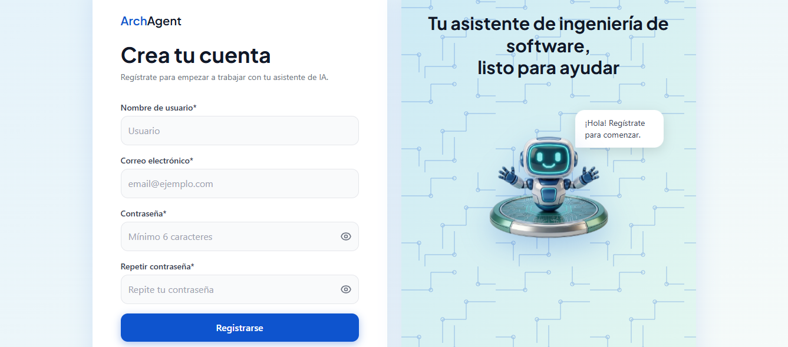

### Iniciar sesión

En visitas posteriores ingresa tu **nombre de usuario** y **contraseña** y haz clic en **Iniciar sesión**. La sesión dura un tiempo limitado (por defecto 60 minutos); cuando expira, la app te devuelve al inicio de sesión.

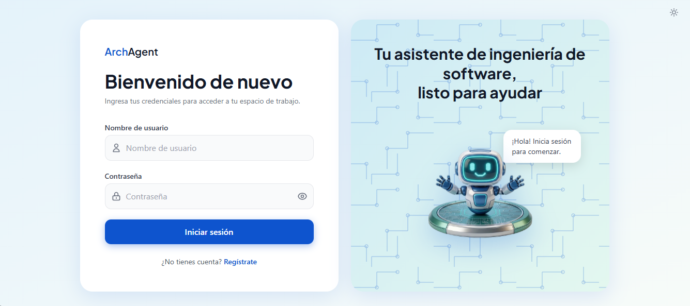

---

## 2. Conocer la interfaz

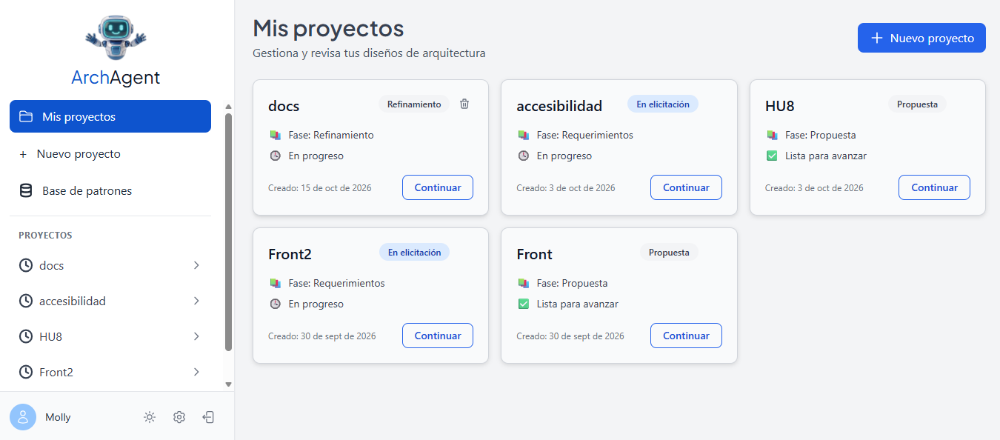

| Zona | Qué contiene |
|------|--------------|
| **Barra lateral — navegación** | Logo *ArchAgent* y los accesos **Mis proyectos**, **+ Nuevo proyecto**, **Proyecto actual** (vuelve al chat del último proyecto abierto) y **Base de patrones**. |
| **Barra lateral — Proyectos** | Tus proyectos. Al hacer clic en uno se despliegan sus secciones **Chat** y **Documentos**. |
| **Barra lateral — pie** | Tu nombre de usuario (abre tu perfil) y tres íconos: **tema** claro/oscuro, **Configuración LLM** (engranaje) y **Cerrar sesión**. |
| **Área principal** | La pantalla activa: lista de proyectos, chat, documentos, base de patrones o configuración. |

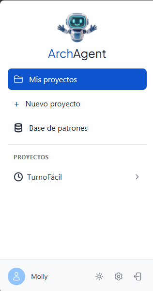

En la **Base de patrones** puedes consultar el catálogo de patrones de arquitectura que el agente usa para fundamentar sus propuestas: buscar por nombre o caso de uso, filtrar por categoría y ver el detalle y los trade-offs de cada uno.

> En pantallas angostas (celular) la barra lateral se oculta; ábrela con el botón **☰** de la barra superior.

---

## 3. Configurar el LLM

Arch Agent no trae un modelo propio: **cada usuario conecta el suyo**. Sin este paso el agente no puede responder.

Haz clic en el ícono de engranaje del pie de la barra lateral. Se abre **Configuración Global del LLM**: la configuración vale para todos tus proyectos. El asistente tiene tres pasos: **URL base**, **API Key** y **Modelo**.

### Paso 1 — URL base

Pega la URL base del proveedor y haz clic en **Continuar**. El asistente verifica que la URL responda como una API compatible con OpenAI.

| Proveedor | URL base |
|-----------|----------|
| OpenAI | `https://api.openai.com/v1` |
| OpenRouter | `https://openrouter.ai/api/v1` |
| Groq | `https://api.groq.com/openai/v1` |
| DeepSeek | `https://api.deepseek.com/v1` |
| Together AI | `https://api.together.xyz/v1` |
| Ollama (local) | `http://host.docker.internal:11434/v1` |
| LM Studio (local) | `http://host.docker.internal:1234/v1` |
| vLLM (self-hosted) | `http://host.docker.internal:8000/v1` |

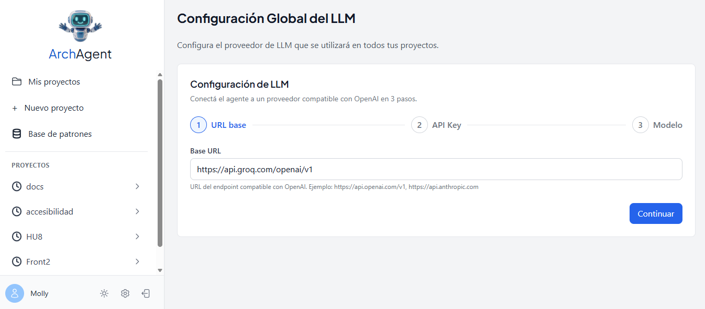

### Paso 2 — API Key

Pega la clave del proveedor y haz clic en **Continuar**. El asistente prueba la conexión real. La clave **se guarda cifrada** y solo cuando confirmas el paso 3; después nunca se vuelve a mostrar completa.

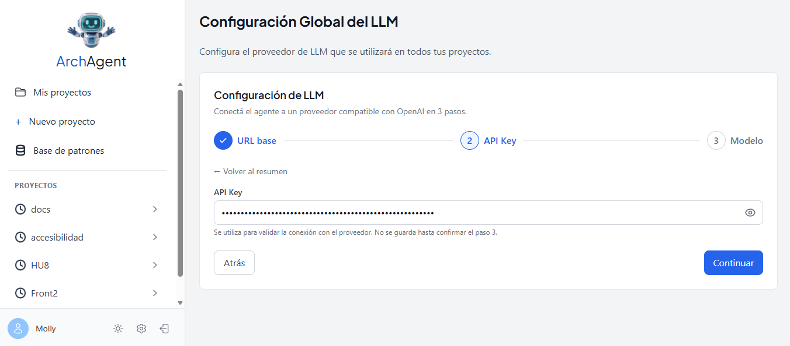

### Paso 3 — Modelo

Elige el modelo de la lista desplegable. Los modelos se agrupan según su calidad (puntaje **MMLU**):

| Grupo | Significado | ¿Se puede elegir? |
|-------|-------------|-------------------|
| **Recomendados (Tier 1)** | MMLU ≥ 85 | Sí, se aprueba automáticamente. |
| **Sin score conocido** | MMLU entre 60 y 85, o desconocido | Sí, pero sin garantía de calidad. |
| *(no aparece)* | MMLU < 60 | No: se bloquea por baja calidad. |

¿Tu modelo no está en la lista (por ejemplo, un fine-tune)? Haz clic en **No encuentro mi modelo — escribir manualmente** y escribe el nombre exacto del modelo en el campo de texto (con **Volver al listado** regresas a la lista). Para terminar, haz clic en **Guardar**.

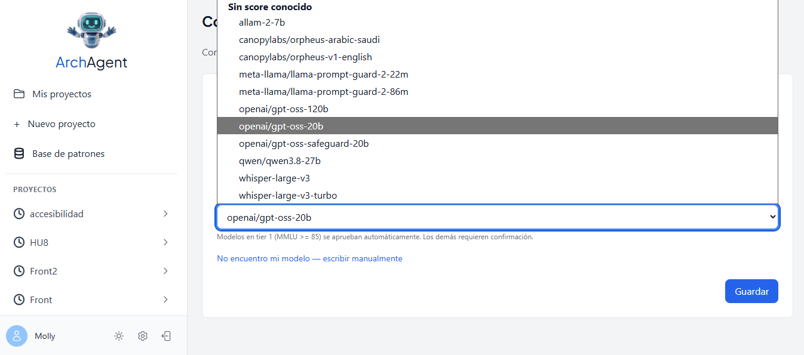

### Cambiar la configuración más adelante

Si ya tienes una configuración guardada, verás **Tu configuración actual** (URL base, modelo y la API key oculta) con dos opciones:

- **Cambiar modelo** — salta directo al paso 3 manteniendo URL y clave.
- **Cambiar todo** — vuelve al paso 1.

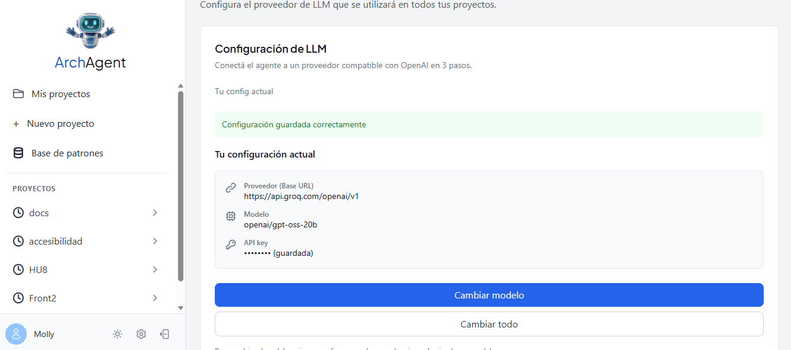

---

## 4. Crear un proyecto

1. Haz clic en **+ Nuevo proyecto**.
2. **Nombre** (obligatorio): `TurnoFácil`.
3. **Descripción** (opcional, pero ayuda al agente): `App web para que clínicas pequeñas gestionen turnos, recordatorios y cancelaciones de pacientes.`
4. Haz clic en **Crear**.

La app abre el **chat** del proyecto, en la fase **Requerimientos**. Arriba ves el nombre del proyecto y las cuatro fases, con la actual resaltada.

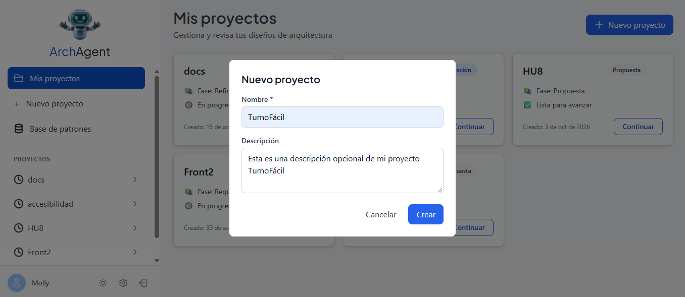

En **Mis proyectos** cada tarjeta muestra:

- El nombre, la descripción y una etiqueta de estado (**En elicitación**, **Propuesta**, **Refinamiento**, **Revisión** o **Completado**).
- **Fase:** la fase actual.
- **Lista para avanzar** (la fase actual ya está aprobada) o **En progreso**.
- El botón **Continuar** para retomar el proyecto (**Ver arquitectura** si ya está completado).

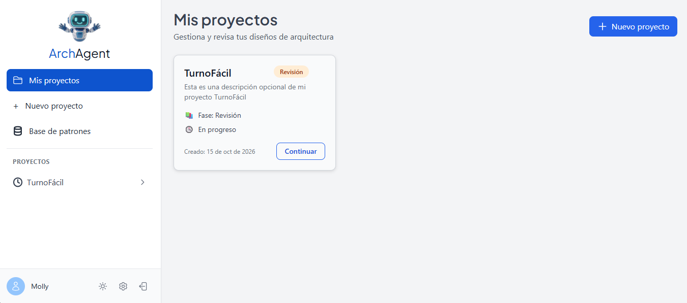

---

## 5. Subir documentos de contexto

Si ya tienes material (actas de reunión, notas, especificaciones), súbelo para que el agente lo tenga en cuenta.

- **Formatos:** PDF (`.pdf`) y Markdown (`.md`).
- **Tamaño máximo:** 10 MB por archivo.

Hay dos formas de subirlos:

1. **Desde Documentos** (barra lateral, dentro del proyecto): se abre **Subida de archivos — {nombre del proyecto}**. Arrastra el archivo a la zona de carga o haz clic para elegirlo. Debajo, en **Documentos subidos**, ves la lista de documentos y puedes eliminarlos.
2. **Desde el chat** de las fases Propuesta, Refinamiento y Revisión: con el clip junto al cuadro de texto. En la fase Requerimientos el chat no permite adjuntar; usa **Documentos**.

Si subes un archivo con un nombre que ya existe, la app te pregunta qué hacer:

| Opción | Resultado |
|--------|-----------|
| **Reemplazar** | Sube una nueva versión que reemplaza a la anterior. |
| **Subir con sufijo** | Guarda el archivo como uno nuevo, con un sufijo en el nombre. |
| **Cancelar** | No sube nada. |

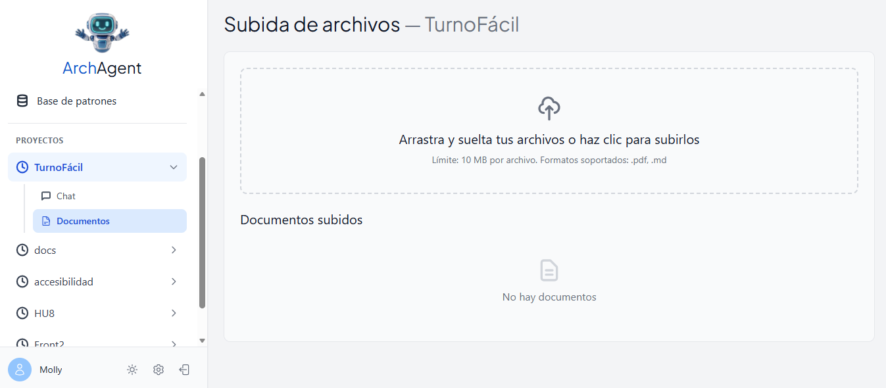

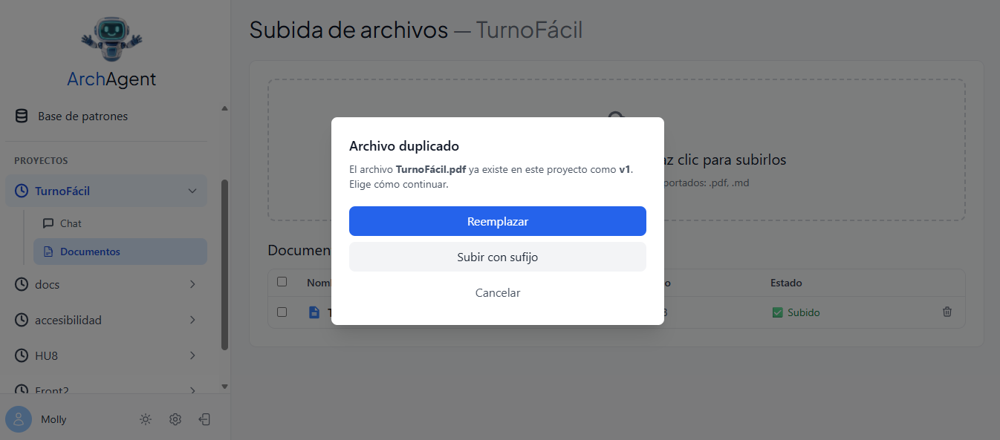

> **Tip:** si subes un documento nuevo después de que el agente ya generó el resumen de requerimientos, usa **Solicitar cambios** en el resumen para que lo incorpore.

---

## 6. Fase 1 — Requerimientos (elicitación)

El objetivo de esta fase es que el agente entienda **qué** hay que construir. Lo hace con preguntas progresivas, una por vez.

### Responder las preguntas

Al entrar al chat verás el aviso *"Voy a hacerte preguntas para entender tu proyecto"*. Haz clic en **Comenzar elicitación** y el agente te muestra la primera pregunta. Responde en el cuadro **"Escribe tu respuesta..."** y presiona Enter (Shift+Enter agrega una línea nueva). Ejemplo de conversación:

> **Agente:** ¿Qué problema resuelve el sistema y para quién?
>
> **Tú:** Las clínicas pequeñas manejan los turnos por teléfono y planillas; se pierden turnos y hay muchas ausencias. Lo usarían recepcionistas, médicos y pacientes.
>
> **Agente:** ¿Cuáles son las funcionalidades indispensables?
>
> **Tú:** Reservar y cancelar turnos online, agenda por profesional, recordatorios por email/WhatsApp y un panel de ausencias.

Mientras el agente piensa verás tres puntos animados. Responde con el mayor detalle posible: volumen esperado de usuarios, presupuesto, tecnologías obligatorias o prohibidas, requisitos de disponibilidad o seguridad, etc. Si el proveedor del LLM falla, aparece el error con el enlace **Reintentar**.

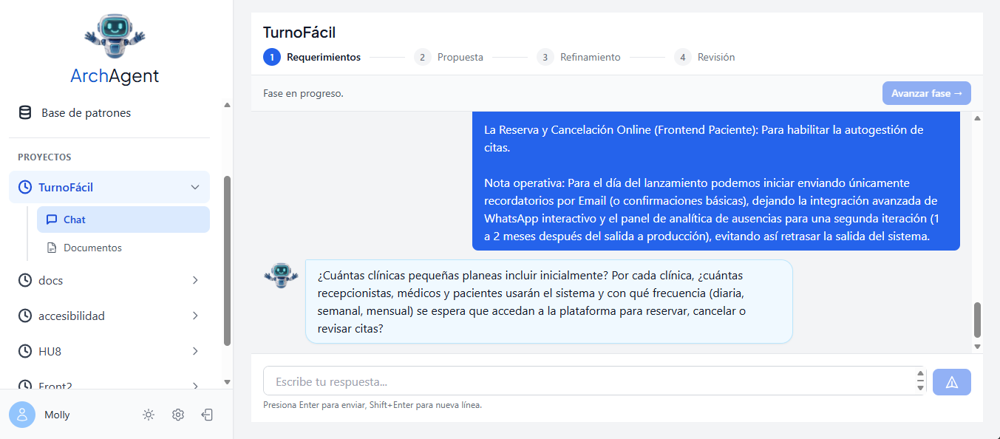

### Validar el resumen

Cuando el agente tiene suficiente información, muestra el **Resumen del proyecto** con:

- **Problema** y **Usuarios**
- **Funcionalidades**
- **Restricciones**
- **Atributos de calidad** (rendimiento, disponibilidad, seguridad…)

Debajo aparece la pregunta **"¿Apruebas este resumen?"** con tres botones:

| Botón | Qué hace |
|-------|----------|
| **✓ Aprobar** | Da por buenos los requerimientos. La fase queda lista para avanzar. |
| **✎ Solicitar cambios** | Abre un campo para describir qué te gustaría cambiar. Escribe el ajuste y haz clic en **Enviar cambios**; el agente retoma la conversación y regenera el resumen. |
| **✕ Rechazar y reiniciar** | Pide confirmación y, si aceptas, descarta el resumen y reinicia la elicitación desde cero (se pierde el progreso de la fase). |

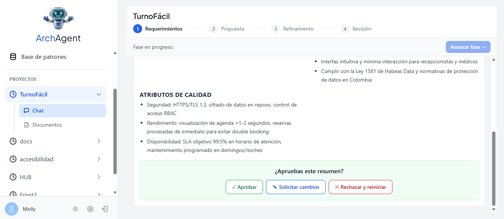

### Avanzar de fase

Al aprobar verás **"✓ Resumen aprobado"** y, en la barra superior del chat, el estado cambia a **"Fase lista para avanzar."**. Haz clic en **Avanzar fase →** para pasar a la fase Propuesta.

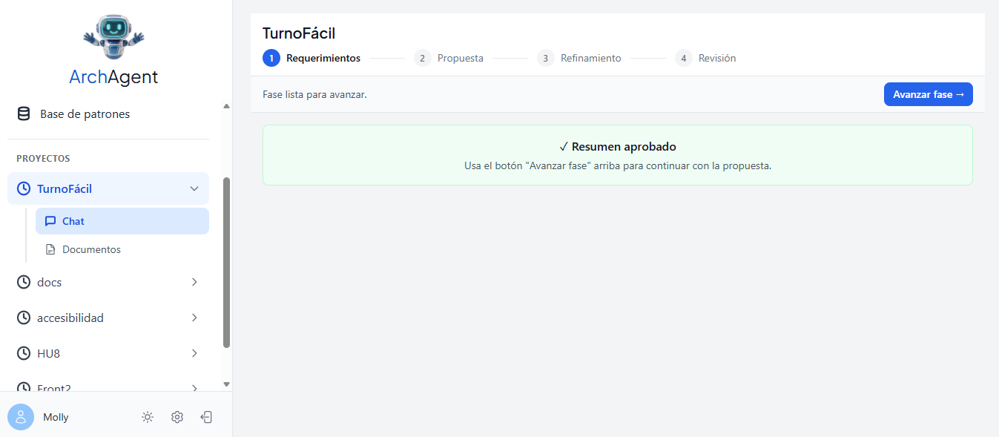

---

## 7. Fase 2 — Propuesta de arquitectura

En esta fase el agente propone **cómo** construirlo, apoyándose en su base de patrones de arquitectura (capas, hexagonal, microservicios, monolito modular, event-driven, CQRS, serverless, etc.).

Puedes consultar esa base en cualquier momento desde **Base de patrones** en la barra lateral: cada patrón muestra su categoría, descripción, casos de uso, trade-offs (ventajas y desventajas) y cuándo no usarlo.

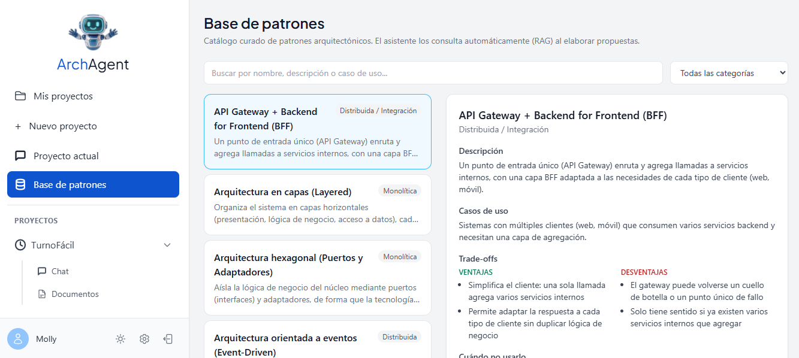

### Generar la propuesta

En la tarjeta **Propuesta de arquitectura** haz clic en **Generar propuesta**. El texto aparece a medida que se genera (*streaming*). La propuesta incluye normalmente:

- Estilo/patrón de arquitectura recomendado y su justificación.
- Componentes principales y sus responsabilidades.
- **Tabla de trade-offs** comparando alternativas.
- **Citas** a los patrones de la base de patrones que respaldan la decisión, con su porcentaje de similitud.

Si el agente no encuentra patrones relacionados en la base de patrones, al pie de la propuesta verás el aviso **"Sin patrones recuperados de la base vectorial: propuesta basada en el conocimiento general del modelo"**. En ese caso la propuesta no trae citas con porcentaje de similitud y los patrones que menciona salen del conocimiento general del modelo.

Junto al título se indica el número de **iteración**, y la etiqueta de la esquina muestra el estado: **Pendiente de decisión** mientras no decidas, o **Aprobada**.

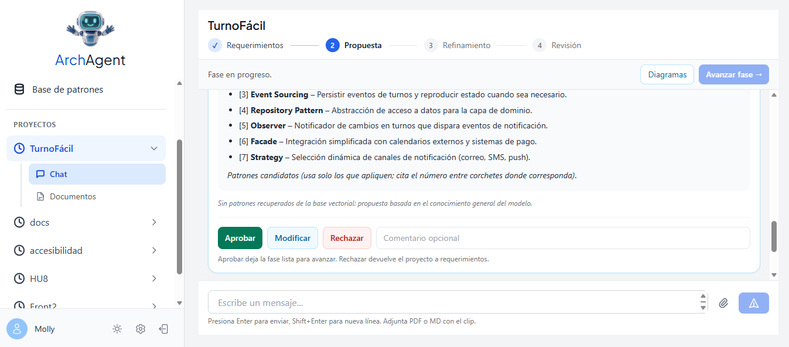

### Decidir sobre la propuesta

Debajo de la propuesta tienes:

| Control | Qué hace |
|---------|----------|
| **Aprobar** | Acepta la propuesta y deja la fase lista para avanzar. |
| **Modificar** | Abre el cuadro **"¿Qué debería cambiar?"** para escribir feedback (ej.: *"agregar caché con Redis"*, *"usar PostgreSQL en vez de MongoDB"*). Haz clic en **Generar nueva iteración**. |
| **Rechazar** | Pide confirmación y **devuelve el proyecto a la fase Requerimientos**; esa propuesta ya no admite más iteraciones. Úsalo solo si los requerimientos están mal; para ajustar la propuesta, usa **Modificar**. |
| **Comentario opcional** | Nota breve que queda registrada junto con tu decisión de aprobar o rechazar. |

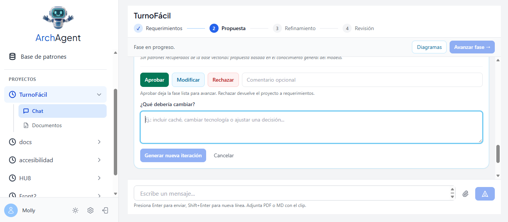

Mientras se genera una nueva iteración verás **"Generando nueva iteración..."**; si la generación se cancela o falla, **la versión actual se conserva**. Cada iteración muestra arriba, como **Ajuste solicitado**, el feedback que la originó.

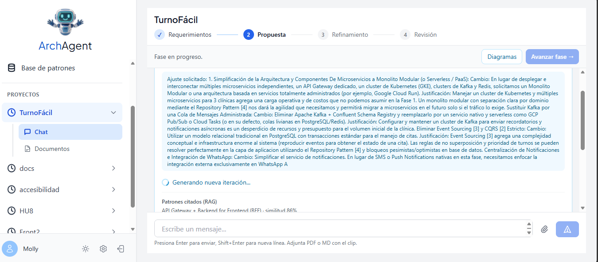

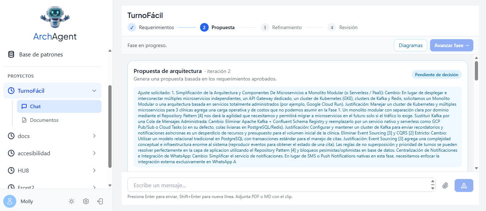

La cantidad de iteraciones tiene un tope; al alcanzarlo, la app te pide que apruebes o rechaces la propuesta.

### Iteraciones de la sesión

Cuando generaste más de una iteración, al pie de la tarjeta aparece **"N iteraciones generadas en esta sesión. Se muestra la más reciente."**. La tarjeta siempre muestra la iteración más reciente.

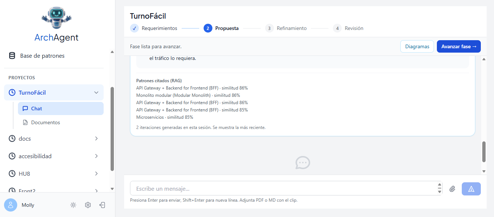

Con la propuesta aprobada, haz clic en **Avanzar fase →**.

---

## 8. Fase 3 — Refinamiento (diagrama)

En esta fase se genera y ajusta el **diagrama** de la propuesta aprobada (en formato Mermaid, convertido en imagen). Al entrar, el chat está vacío: **pídele el diagrama al agente**, por ejemplo:

> *Genera el diagrama de la propuesta aprobada.*

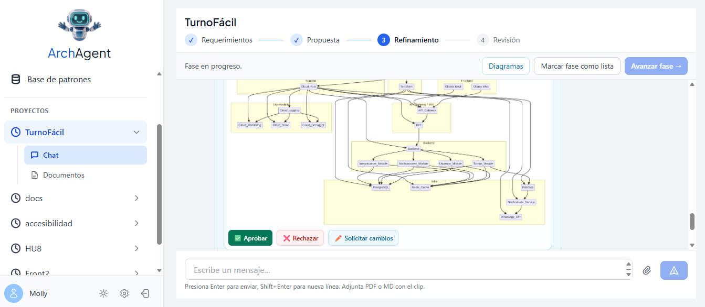

Si el diagrama no se pudo convertir en imagen, o incluye componentes que no están respaldados por la documentación consultada, verás un aviso debajo de la respuesta.

### Ver el diagrama en grande

Haz clic sobre la imagen para abrir el **visor ampliado**. En la barra de **Controles** tienes:

| Control | Qué hace |
|---------|----------|
| **−** / **+** | Alejan o acercan el diagrama. |
| **Porcentaje** (ej. 100%) | Muestra el zoom actual. |
| **200%** | Vuelve al zoom inicial. |
| **Abrir original** | Abre la imagen en una pestaña nueva. |
| **Cerrar** | Cierra el visor (también con la tecla Esc). |

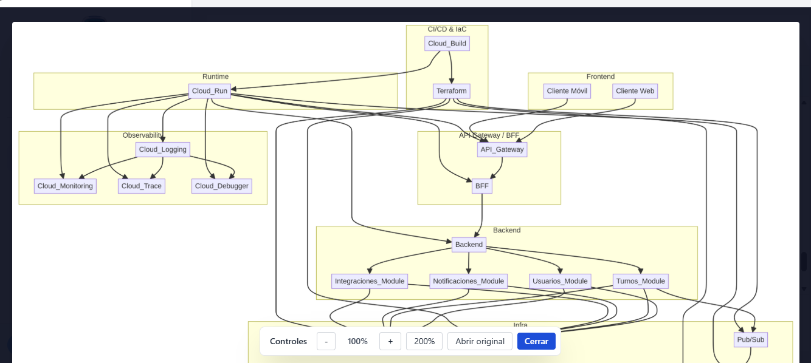

### Decidir sobre el diagrama

Cada diagrama del chat tiene sus propios botones:

| Botón | Qué hace |
|-------|----------|
| **✅ Aprobar** | Registra el diagrama como aprobado. |
| **❌ Rechazar** | Lo marca como rechazado. |
| **✏️ Solicitar cambios** | Abre *"¿Qué debe ajustarse en el diagrama?"*; describe el cambio y haz clic en **Enviar ajuste**. El agente modifica el diagrama existente según tu pedido (no lo rehace desde cero). |

También puedes seguir conversando con el agente en el chat (cuadro **"Escribe un mensaje..."**) para hacerle preguntas sobre la arquitectura o pedir aclaraciones.

Cuando estés conforme, haz clic en **Marcar fase como lista** y luego en **Avanzar fase →** para pasar a Revisión.

---

## 9. Fase 4 — Revisión

Es la última fase del flujo. No tiene una pantalla propia: el chat sigue disponible para consultar al agente sobre la arquitectura final.

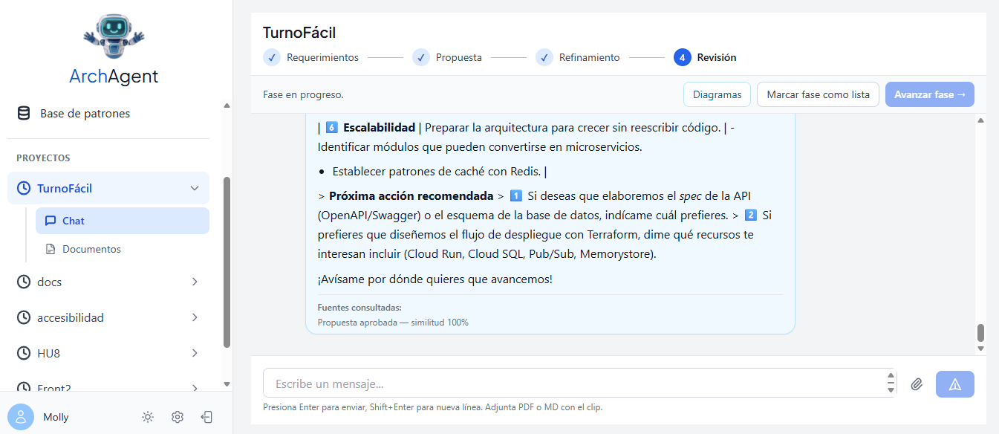

En **Mis proyectos**, la tarjeta del proyecto muestra la etiqueta **Revisión**:

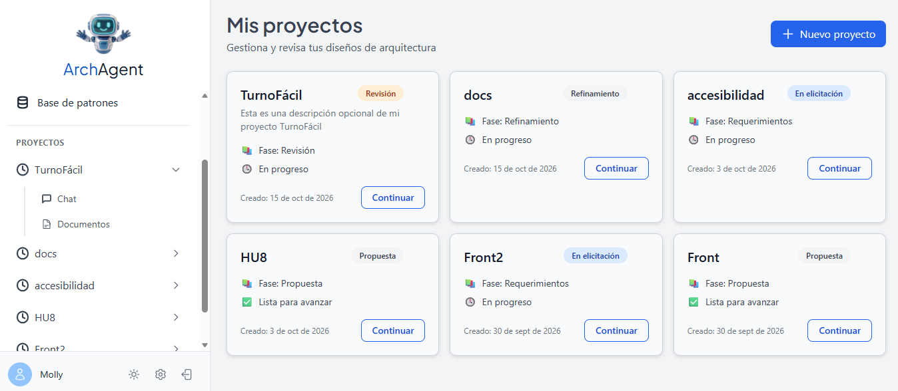

Cuando termines, haz clic en **Marcar fase como lista**. El proyecto pasa a mostrarse como **Completado** y su botón cambia a **Ver arquitectura**.

---

## 10. Historial de diagramas

Desde la fase Propuesta en adelante, la barra superior del chat tiene el botón **Diagramas**. Abre el panel **Historial de diagramas**, con todas las versiones de diagramas del proyecto y su estado:

- ✅ **Aprobado**
- ❌ **Rechazado**
- ✏️ **Cambios solicitados**
- **Sin decisión**

Cada versión muestra la miniatura del diagrama, la fecha y hora en que se generó y su estado.

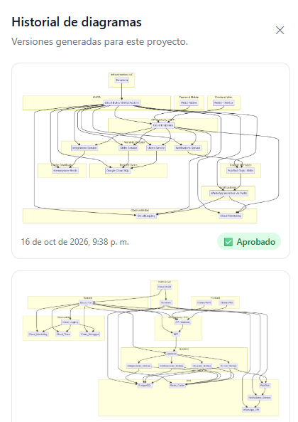

El panel es **solo de consulta**: las decisiones se toman en el chat, sobre cada diagrama. Ciérralo con **✕**.

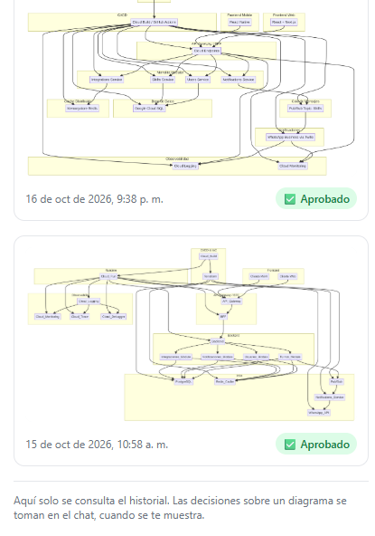

---

## 11. Perfil y cuenta

Haz clic en tu nombre de usuario, en el pie de la barra lateral, para abrir tu perfil. Ahí puedes:

- Ver y editar tu **nombre de usuario** y **correo electrónico** (guarda con **Guardar cambios**), y ver la fecha de **Miembro desde**.
- **Cambiar la contraseña**: ingresa la actual y la nueva, que debe cumplir las mismas reglas que al registrarte (al menos **8** caracteres, una mayúscula, un número y un carácter especial).

Para salir, usa el ícono **Cerrar sesión** del pie de la barra lateral.

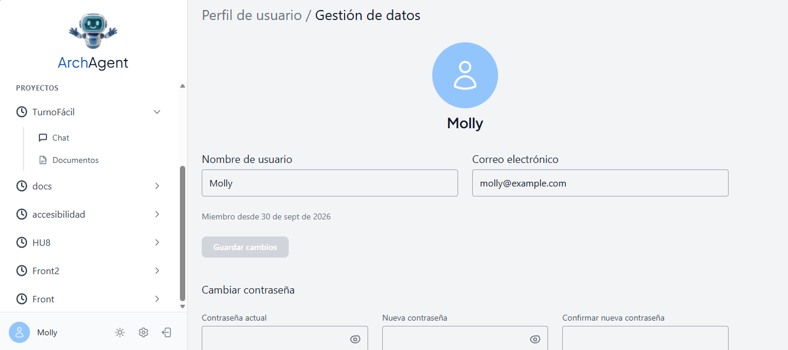

---

**Siguiente:** [FAQ](03-faq.md) · [Glosario](04-glosario.md) · [Volver al índice](README.md)
